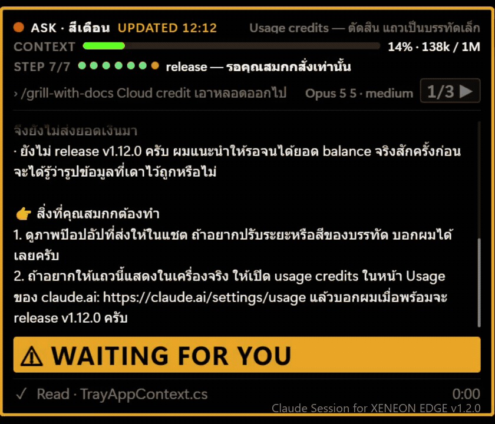
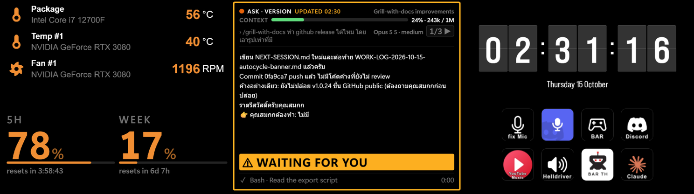
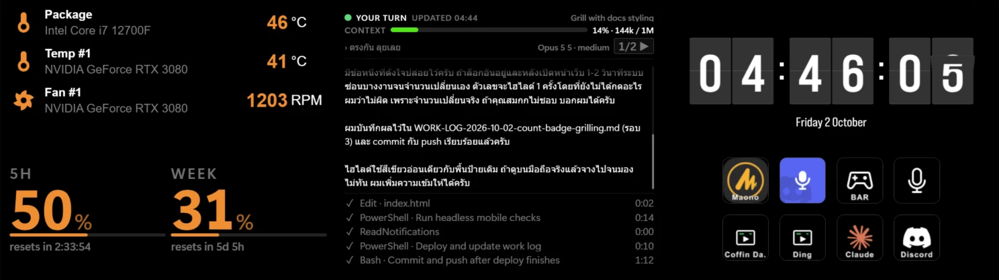

# Claude Session for XENEON EDGE

Shows your live Claude Code session on the CORSAIR XENEON EDGE 14.5" touchscreen. An unofficial, free, MIT-licensed companion that displays your current prompt, latest response, working status, and pending questions—all without breaking your focus on the main screen.

## Features

- **Live session prompt** — the last message you typed to Claude
- **Latest reply** — the most recent response from Claude, stripped of markdown formatting for readability on the small screen
- **Session status** — shows "working" while Claude is thinking or running a tool, and "waiting" when Claude is idle
- **Working-thinking indicator** — displays elapsed time in the session, and flags when Claude is in extended thinking
- **Model and effort** — current model name and effort level (low/high/max/etc.)
- **Step Feed** — the latest tool call of the current turn (e.g., "Read config.json", "Run tests"), with its elapsed time
- **Context window gauge** — a fill bar showing how full the context window is for the current session's model
- **5-hour and 7-day usage** — your Claude usage in the current 5-hour window and 7-day window, as percentages
- **Question alert** — when Claude asks a question (via `AskUserQuestion` or `ExitPlanMode`), the widget shows a blinking border and a large blinking **⚠ WAITING FOR YOU** banner, readable from the corner of your eye; the session with the question always takes the screen. You answer it in Claude Code / Claude Desktop
- **Multi-session support** — when 2 or more sessions are active, a cycle button (X/Y ▶) lets you switch between them; tapping it (or touching the text) holds that session for 60 seconds
- **Auto-cycle** — optional: rotate through the sessions that are currently working every 5, 10, 15, 30 or 60 seconds (off by default; set it in the widget's iCUE settings). It pauses while a question is pending or while you are reading
- **Session title** — optionally shows your custom session title (configurable in iCUE)
- **Step progress** — `STEP 3/6` with one dot per step (green = done, blinking orange = in progress, grey = not started) and the name of the current step, read from Claude's step list or an active `NEXT-SESSION.md`; hidden when there is no unfinished list (iCUE setting *Show Step Progress*)

## Screenshots

The Claude widget (center) on a real XENEON EDGE, next to other iCUE widgets.

Live demo (v1.2.0) — step progress dots under the context gauge, the latest reply and the WAITING FOR YOU banner:



A question is pending — blinking border and the WAITING FOR YOU banner (v1.1.0):



Your turn — Claude has finished and is waiting for you (v1.0.0, which still listed the last 5 steps):



## Requirements

- **Windows 10 or 11** (x64)
- **CORSAIR XENEON EDGE** 14.5" touchscreen
- **iCUE 5** (minimum version 5.47)
- **Claude Code CLI** or **Claude Desktop** (logged in with your Anthropic account)

No .NET install is needed — the release build is self-contained.

## Install

1. Download `ClaudeSession-vX.X.X.zip` from [Releases](https://github.com/SKGoC-CLI/claude-session-for-xeneon-edge/releases).
2. Extract the whole zip to a folder (don't run it from inside the zip).
3. Double-click `Install.cmd` (no administrator rights needed). Windows SmartScreen may warn because the files are unsigned; click **More info** → **Run anyway**.
4. Open iCUE, go to your XENEON EDGE dashboard, and import the `.icuewidget` file from the same folder.

`Install.cmd` copies the bridge to `%LOCALAPPDATA%\ClaudeEdgeBridge\`, adds it to your Windows Startup folder, and starts it. It runs in the background with no window and listens at `http://127.0.0.1:8975` (this PC only).

## Uninstall

1. Double-click `Uninstall.cmd`. It stops the bridge, removes the Startup shortcut and deletes `%LOCALAPPDATA%\ClaudeEdgeBridge\`.
2. In iCUE, remove the widget from your XENEON EDGE dashboard.

## Privacy & Security

- **ClaudeEdgeBridge.exe** is a small background program (no window). It listens only on `http://127.0.0.1:8975` (this PC only, not the network).
- It reads your Claude Code session transcripts from `%USERPROFILE%\.claude\projects\` to show the current prompt, reply, and status. Nothing from them leaves your PC.
- To show usage percentages, it reads your existing Claude login token (read-only) from `%USERPROFILE%\.claude\.credentials.json` or from Claude Desktop's local encrypted token cache (decrypted with Windows DPAPI as your user), and sends it only to `https://api.anthropic.com/api/oauth/usage` — the same endpoint Claude uses. It never refreshes, rotates, stores, or logs the token.
- **No telemetry, no analytics, no other network calls.**
- Websites open in your browser cannot read the bridge's data: cross-origin access is allowed only for the iCUE widget (`file://`) and localhost pages, and requests addressed to any other host name are refused (DNS-rebinding guard).
- **Anything shown on the EDGE screen is visible to anyone near your desk.**
- The code is open — read `bridge/` to verify.

## Build from Source

### Prerequisites

- **.NET 8 SDK** (https://dotnet.microsoft.com/download)
- **PowerShell 5.1** or later

### Build Steps

1. In PowerShell, navigate to the repo root:
   ```powershell
   cd path\to\claude-session-for-xeneon-edge
   dotnet build bridge -c Release
   ```

2. Create the iCUE widget package:
   ```powershell
   .\tools\pack-widget.ps1
   ```

   This writes `dist\claudesession-vX.X.X.icuewidget`, ready to import into iCUE.

3. Run the self-test:
   ```powershell
   bridge\bin\Release\net8.0-windows\ClaudeEdgeBridge.exe --selftest
   ```

   It should print `SELFTEST OK` if everything is working.

## Troubleshooting

**Widget is blank or not updating:**
- Check that `ClaudeEdgeBridge.exe` is running in Task Manager (search for "ClaudeEdgeBridge").
- Open your browser and navigate to `http://127.0.0.1:8975/session.json` — you should see JSON output. If it shows an error, the bridge is not finding your Claude Code sessions.
- Check the bridge logs at `%APPDATA%\ClaudeEdgeBridge\logs\`.
- Make sure the **Bridge port** in the widget's iCUE settings is `8975`.

**Port 8975 is already in use:**
- The bridge always uses port 8975. Close the other program that uses it, then start the bridge again (run `Install.cmd`, or sign out and back in).

## Disclaimer

Unofficial. Not affiliated with, endorsed by, or sponsored by Corsair or Anthropic. CORSAIR, iCUE, and XENEON are trademarks of Corsair; Claude is a trademark of Anthropic.

## License

MIT License. See [LICENSE](LICENSE) for details.
